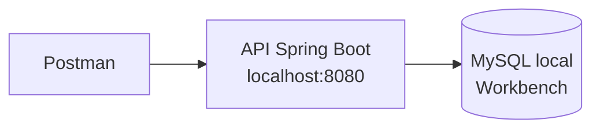
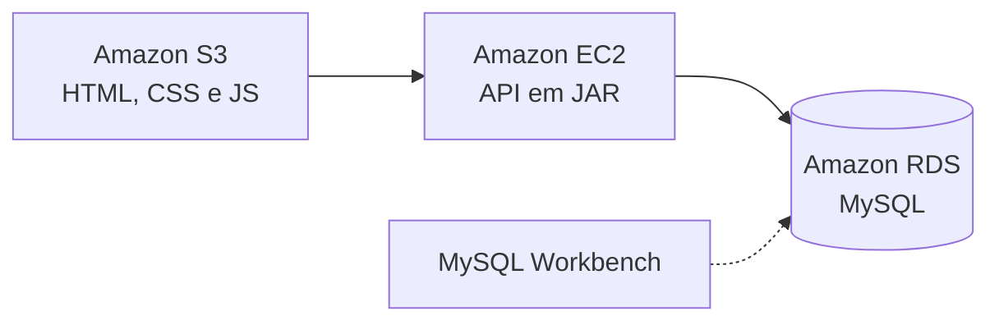

# API de Usuários: do localhost à AWS ☁️

Projeto desenvolvido nas aulas de Backend do curso de **Análise e Desenvolvimento de Sistemas**. É a minha primeira API: um **CRUD de usuários** (cadastrar, consultar, atualizar e excluir) feito em Java com Spring Boot, testado primeiro no Postman e depois publicado na AWS com uma interface web simples.

## 🏗️ Arquitetura

O projeto teve duas etapas.

**1. Execução local**



**2. Implantação na AWS**



- **Frontend:** arquivos estáticos hospedados no **S3**.
- **Backend:** API Spring Boot compilada em JAR, rodando em uma instância **EC2** com Java instalado.
- **Banco de dados:** MySQL no **RDS**, criado no console da AWS. O MySQL Workbench foi conectado ao endpoint do RDS para gerenciar o banco.

## 🛠️ Tecnologias

| Camada | Tecnologia |
|---|---|
| Backend | Java 17, Spring Boot 4.1.1, Spring Data JPA (Hibernate) |
| Banco de dados | MySQL 8 (local e Amazon RDS) |
| Frontend | HTML, CSS e JavaScript (`fetch`) |
| Testes de API | Postman |
| Nuvem | AWS (EC2, RDS e S3) |

## 📁 Estrutura do projeto

```
├── apiusuarios/               # Backend (Spring Boot)
│   ├── src/main/java/com/senai/apiusuarios/
│   │   ├── config/            # CorsConfig (libera o frontend)
│   │   ├── controller/        # UsuarioController (endpoints REST)
│   │   ├── model/             # Usuario (entidade)
│   │   └── repository/        # UsuarioRepository (acesso ao banco)
│   ├── src/main/resources/application.properties
│   └── pom.xml
└── FrontEnd/                  # Interface web
    ├── index.html
    ├── CSS/style.css
    └── JS/script.js
```

## 🔌 Endpoints

Base: `/usuarios`

| Método | Rota | Descrição |
|---|---|---|
| `GET` | `/usuarios` | Lista todos os usuários |
| `GET` | `/usuarios/{id}` | Busca um usuário pelo id |
| `POST` | `/usuarios` | Cadastra um novo usuário |
| `PUT` | `/usuarios/{id}` | Atualiza o usuário |
| `DELETE` | `/usuarios/{id}` | Exclui o usuário |

Exemplo de corpo para `POST` e `PUT`:

```json
{
  "nome": "Maria"
}
```

O `id` é gerado automaticamente (auto incremento).

## ▶️ Como rodar

### Pré-requisitos

- Java 17
- MySQL (local ou RDS)
- Maven (opcional, o projeto já inclui o Maven Wrapper)

### 1. Banco de dados

Crie o banco no MySQL:

```sql
CREATE DATABASE api_usuarios;
```

A tabela é criada automaticamente pelo Hibernate na primeira execução (`spring.jpa.hibernate.ddl-auto=update`).

### 2. Configure a conexão

Em `apiusuarios/src/main/resources/application.properties`, substitua os placeholders pelos seus dados:

```properties
spring.datasource.url=jdbc:mysql://SEU_ENDPOINT:3306/api_usuarios
spring.datasource.username=SEU_USUARIO
spring.datasource.password=SUA_SENHA
```

- Rodando **localmente**, use `localhost` no lugar do endpoint.
- Rodando na **AWS**, use o endpoint do RDS.

### 3. Suba a API

```bash
cd apiusuarios
./mvnw spring-boot:run
```

No Windows: `mvnw.cmd spring-boot:run`. A API sobe em `http://localhost:8080`.

Para gerar o JAR (como foi feito para a EC2):

```bash
./mvnw clean package
java -jar target/apiusuarios-0.0.1-SNAPSHOT.jar
```

### 4. Configure e abra o frontend

Em `FrontEnd/JS/script.js`, ajuste a URL da API:

```javascript
const API_URL = "http://localhost:8080/usuarios";   // local
// const API_URL = "http://IP_PUBLICO_DA_EC2:8080/usuarios";   // AWS
```

Depois, abra o `index.html` no navegador (ou envie a pasta `FrontEnd` para um bucket S3 com hospedagem de site estático).

## ☁️ Dicas para o deploy na AWS

- **Security Group da EC2:** libere a porta `8080` para receber as requisições.
- **Security Group do RDS:** libere a porta `3306` para a EC2 (e para o seu IP, se for usar o Workbench).
- **CORS:** a API está com `allowedOrigins("*")`, o que funciona bem para estudo. Em produção, libere apenas o endereço do site no S3.

## 🔐 Segurança

Este repositório **não contém credenciais reais**. Nunca publique usuário e senha do banco no GitHub. Uma melhoria planejada é mover essas informações para **variáveis de ambiente**:

```properties
spring.datasource.url=${DB_URL}
spring.datasource.username=${DB_USER}
spring.datasource.password=${DB_PASSWORD}
```

## 📚 O que eu pratiquei

- Criação de uma API REST com Spring Boot
- Verbos HTTP: POST, GET, PUT e DELETE
- Integração entre aplicação e banco de dados relacional
- Consumo de API com JavaScript (`fetch`)
- Deploy em nuvem com EC2, RDS e S3

